<table>
  <tr>
    <td width="220" align="center">
      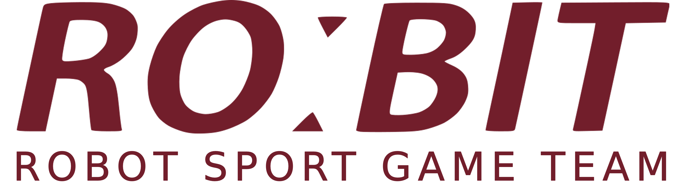
    </td>
    <td>
      <h2>RO:BIT Intelligence Robot Team</h2>
      Perception · Navigation · Manipulation — from custom hardware to VLM-driven autonomy. 
      Kwangwoon University · Korea's first robot sports game team · Since 2006  
      
      
      
      
      
    </td>
  </tr>
</table>

 

> RO:BIT is a student self-governing body of Kwangwoon University. We design, machine, build, and program robots for
> rescue, defense, and robot sports — then take them to competitions and run robot events so more students
> fall in love with robotics.

---

## 🏆 2026 Season

<table>
  <tr>
    <td align="center" width="33%">
      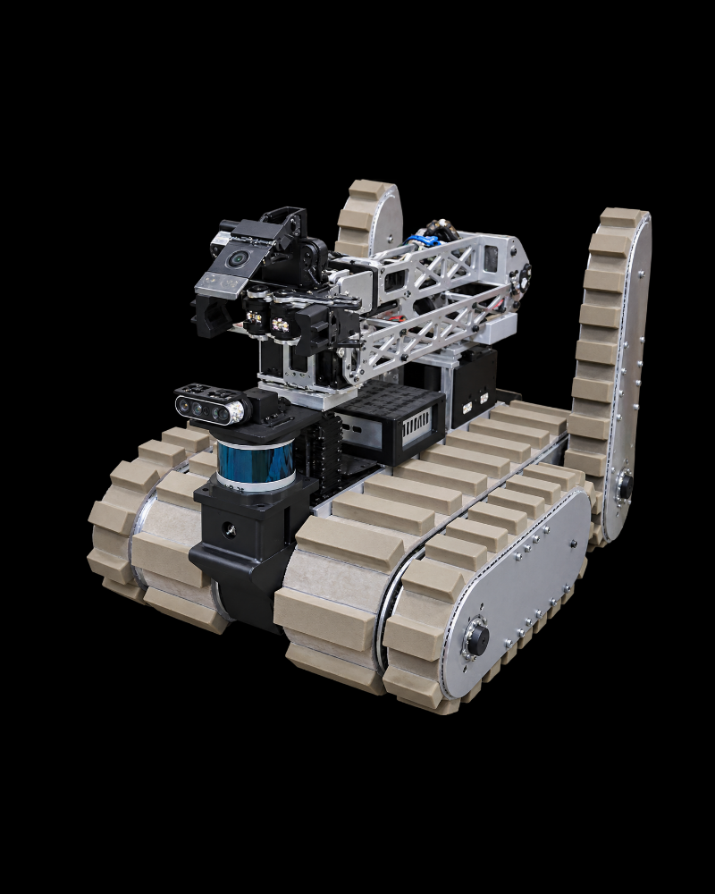 
      <h4>RoboCup Rescue 2026</h4>
      Eclipse · ✅ Qualification passed
    </td>
    <td align="center" width="33%">
      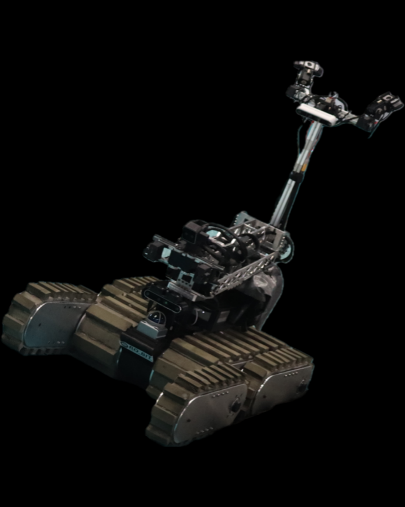 
      <h4>Defense Robot Competition 2026</h4>
      Eclipse · 🥇 1st place
    </td>
    <td align="center" width="33%">
      <a href="https://team-robit.github.io/irc-mani-web/">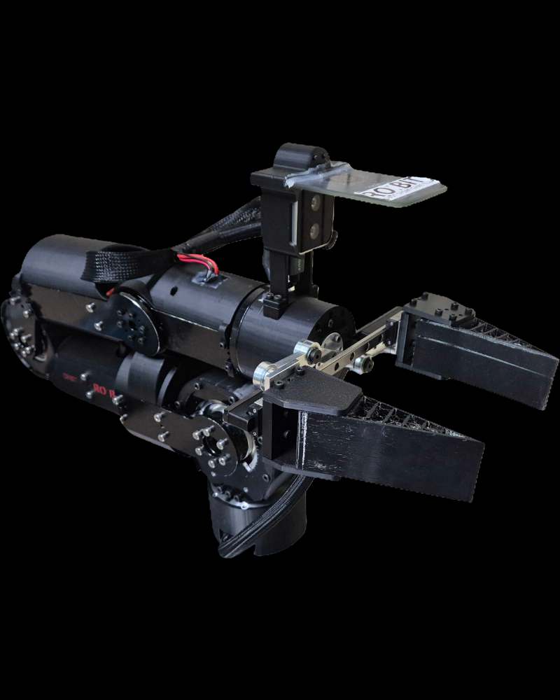</a> 
      <h4>SAFE LAB</h4>
      🥈 2nd place · Intelligent Robot Competition 2026 (Manipulator) Self-built 7-DOF manipulator
    </td>
  </tr>
</table>

---

## 🦾 SAFE LAB — spec sheet

<a href="https://youtu.be/OLy96QEyY1U">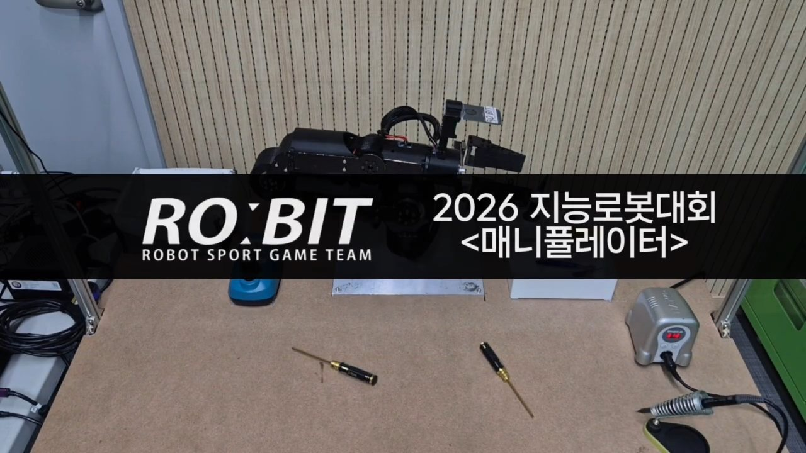</a>
 
<b>An autonomous robot that finds and clears the hazards people leave behind in a lab.</b> 
<a href="https://youtu.be/OLy96QEyY1U">▶ Watch the demo video</a> · <a href="https://team-robit.github.io/irc-mani-web/">Build story →</a>

 

<table>
  <tr>
    <td width="50%" valign="top">
      <h4>Hardware (designed, machined &amp; assembled in-house)</h4>
      <table>
        <tr><td><b>Arm</b></td><td>7-DOF, QDD (Quasi-Direct Drive)</td></tr>
        <tr><td><b>Payload</b></td><td>3 kg rated · 5 kg max</td></tr>
        <tr><td><b>Reach / Weight</b></td><td>77 cm · 7.3 kg</td></tr>
        <tr><td><b>Control</b></td><td>Custom low-level motor controller</td></tr>
        <tr><td><b>Sensing</b></td><td>RGB-D · thermal · wrist camera</td></tr>
        <tr><td><b>Compute</b></td><td>Jetson AGX + RTX 4060 laptop</td></tr>
      </table>
    </td>
    <td width="50%" valign="top">
      <h4>Task success rates</h4>
      <table>
        <tr><td>Hazard identification</td><td align="right"><b>98.5%</b></td></tr>
        <tr><td>Soldering-iron unplug</td><td align="right"><b>92%</b></td></tr>
        <tr><td>Battery removal</td><td align="right"><b>92%</b></td></tr>
        <tr><td>Workbench tidy-up</td><td align="right"><b>80%</b></td></tr>
        <tr><td>Power-strip off</td><td align="right"><b>70%</b></td></tr>
      </table>
    </td>
  </tr>
</table>

<table>
  <tr>
    <td align="center" width="25%"><b>VLM</b> Qwen3-VL-4B task planning</td>
    <td align="center" width="25%"><b>Imitation learning</b> ACT on LeRobot skill execution</td>
    <td align="center" width="25%"><b>Vision</b> YOLO11n · SAM 2.1 RGB-D + thermal</td>
    <td align="center" width="25%"><b>Motion planner</b> MoveIt 2 · pick_ik ROS 2 Jazzy</td>
  </tr>
</table>

Built by Min Jo Kim (controller · imitation learning · planner), Jeong Yoon Woo (arm design · machining), Ki Hong Park (wiring · demo setup · web), Soo Min Song (VLM · vision)

---

## 🧬 Generations

Every year's robot builds on the last one.

<table>
  <tr>
    <td align="center" width="20%" valign="top">
       
      <h4>SJBot</h4>
      <code>2021</code> 
      First-gen tracked rescue platform with flippers and a camera mast
    </td>
    <td align="center" width="20%" valign="top">
      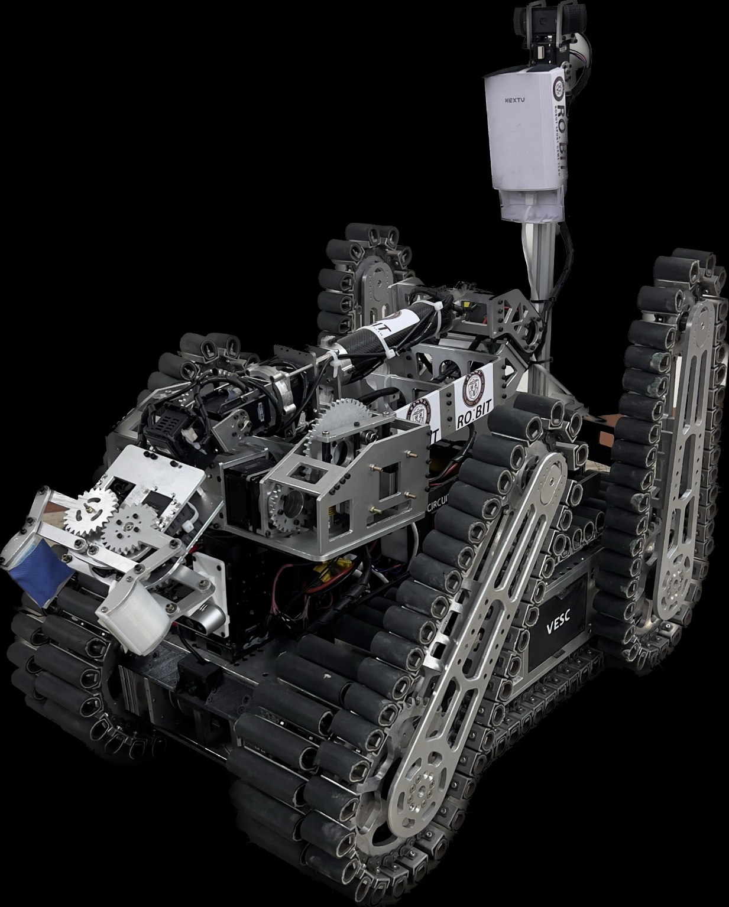 
      <h4>KUBO</h4>
      <code>2022 – 2023</code> 
      Gripper arm, mast camera, VESC motor drive
    </td>
    <td align="center" width="20%" valign="top">
      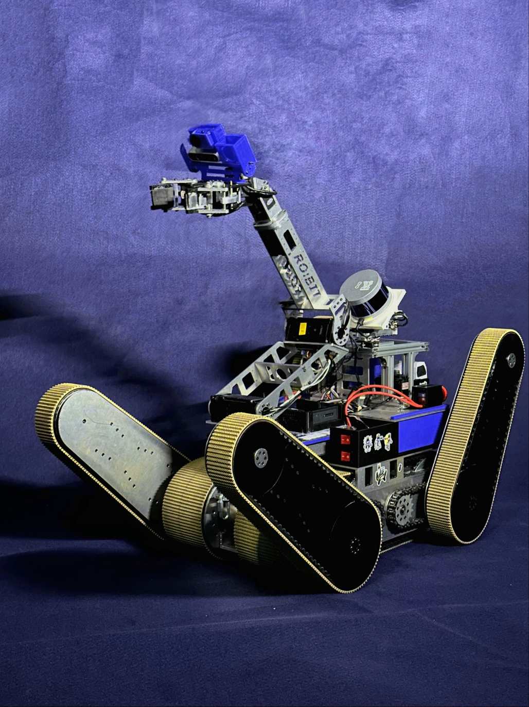 
      <h4>KULS</h4>
      <code>2024</code> 
      Long-reach arm + LiDAR for autonomous perception
    </td>
    <td align="center" width="20%" valign="top">
      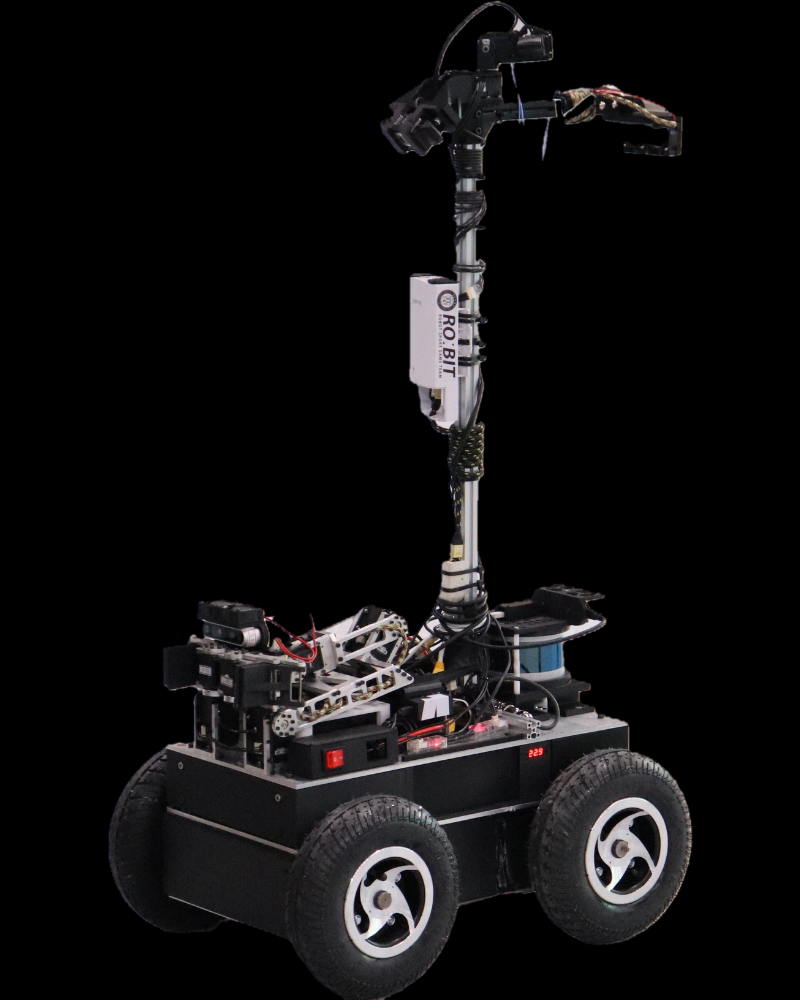 
      <h4>LUCO</h4>
      <code>2025</code> 
      🥇 1st place Defense Robot Competition 2025
    </td>
    <td align="center" width="20%" valign="top">
       
      <h4>Eclipse</h4>
      <code>2026</code> 
      🥇 1st place · Extreme Robot Competition 2025 
      ✅ RoboCup Rescue 2026 · qualification passed 
      🥇 1st place · Defense Robot Competition 2026
    </td>
  </tr>
</table>

<b>More robots</b> — Sumo &amp; TurtleBot3 AutoRace

 
<table>
  <tr>
    <td align="center" width="50%">
      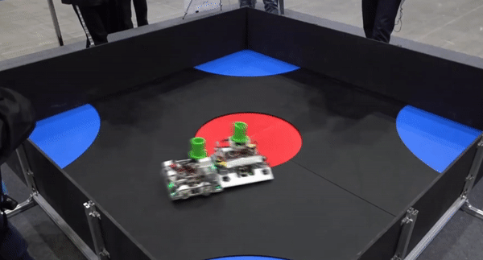 
      <b>Sumo Robot</b> Fast, light, and merciless in the ring.
    </td>
    <td align="center" width="50%">
       
      <b>TurtleBot3 AutoRace</b> Autonomous racing · 2023
    </td>
  </tr>
</table>

---

## 🧠 What makes them smart

<table>
  <tr>
    <td align="center" width="33%">
      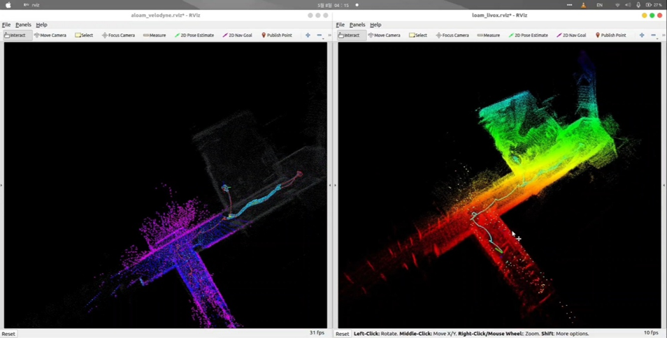 
      <b>SLAM &amp; Navigation</b> LiDAR mapping (A-LOAM / LOAM-Livox) and autonomous path planning
    </td>
    <td align="center" width="33%">
       
      <b>Computer Vision</b> Scene understanding with RGB-D &amp; thermal cameras
    </td>
    <td align="center" width="33%">
      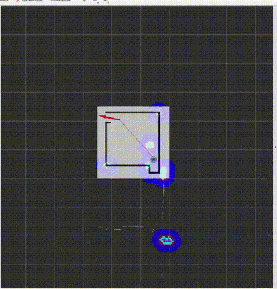 
      <b>Autonomous Driving</b> Costmap navigation &amp; mission execution
    </td>
  </tr>
</table>

---

## 👥 Team

<h4>Currently active</h4>

<table>
  <tr>
    <td align="center" width="16%"><a href="https://github.com/beomsuchoi"> <b>Beom Su Choi</b></a> 19th · 2026 Team Leader Software</td>
    <td align="center" width="16%"><a href="https://github.com/jammay123"> <b>Jae Min Ha</b></a> 19th Software</td>
    <td align="center" width="16%"><a href="https://github.com/kinesis19"> <b>Ki Hong Park</b></a> 19th Circuit design</td>
    <td align="center" width="16%"><a href="https://github.com/kmj060703"> <b>Min Jo Kim</b></a> 20th Software</td>
    <td align="center" width="16%"><a href="https://github.com/mikissm"> <b>Soo Min Song</b></a> 20th Software</td>
    <td align="center" width="16%"><a href="https://github.com/JeongyoonWoo7"> <b>Jeong Yoon Woo</b></a> 20th Circuit design</td>
  </tr>
</table>

<b>Alumni</b> (click to expand)

 

| Gen | Name | Role | |
|:---:|---|---|:---:|
| 18th | Jae Woong So · *2025 Team Leader* | Hardware design | [GitHub](https://github.com/jaewwong) |
| 18th | Jung Uk Byeon | Circuit design | [GitHub](https://github.com/Jeong042) |
| 18th | Sun Kyoung Lee | Software | [GitHub](https://github.com/lee-sunkyoung) |
| 18th | Ji Hyeon Hong | Software | [GitHub](https://github.com/mkdir-sweetiepie) |
| 17th | Seung Hun Lee · *2024 Team Leader* | Software, Hardware design | [GitHub](https://github.com/Leeseunghun03) |
| 17th | Min Seok Lee | Software, Circuit design | [GitHub](https://github.com/minseokle) |
| 17th | Ji Heng Lee | Hardware design | |
| 17th | Myeong Jin Lee | Software | [GitHub](https://github.com/mjlee111) |
| 16th | In Yeop Beak · *2023 Team Leader* | Software | [GitHub](https://github.com/INYUP-BAEK) |
| 16th | Jong Uk Beak | Hardware design | [GitHub](https://github.com/baekjongwook) |

 

## 📮 Contact

<table>
  <tr>
    <td width="100" align="center">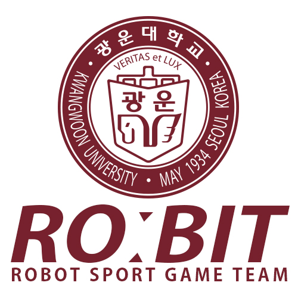</td>
    <td>
      <b>Kwangwoon University</b> · Room 201, Saebitgwan, 20 Gwangun-ro, Nowon-gu, Seoul 01897, Republic of Korea 
      ✉️ GitHub admin — <a href="mailto:robitintelligence@gmail.com">robitintelligence@gmail.com</a>
    </td>
  </tr>
</table>
